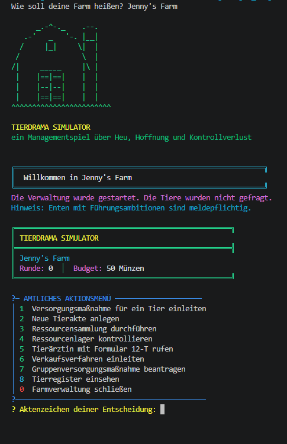

# 🐄 Java Farm Simulation

A Java console application that simulates the day-to-day management of a small farm.

The project was developed during my software development training at CODERS.BAY and focuses on object-oriented design, interactions between multiple classes and managing application state across a larger codebase.

## 🚀 What the application does

The simulation lets the user manage a farm through a console-based interface.

Current features include:

- managing different animal types such as cows, sheep, chickens and ducks
- feeding individual animals or groups of animals
- collecting and selling resources
- tracking hunger and animal health
- diseases and veterinary treatment
- random events during the simulation
- creating additional animals
- managing the farm budget and resource storage
- round-based progression
- a styled console interface

## 📸 Application Preview



[View all application screenshots](screenshots/README.md)

## 🛠 Tech Stack

- Java
- Object-Oriented Programming
- Java Collections

## 🧩 Object-Oriented Design

The project uses several OOP concepts to model the different parts of the farm:

- **Inheritance** – individual animal types extend a common `Animal` base class
- **Interfaces** – behaviours such as resource production and hunger management are represented through interfaces
- **Polymorphism** – different animal types can be handled through shared abstractions
- **Encapsulation** – animal and farm state is managed inside the relevant classes
- **Collections** – groups of animals and resources are managed dynamically

## 📁 Project Structure

```text
src/
├── Main.java
├── animals/
│   ├── Animal.java
│   ├── Cow.java
│   ├── Sheep.java
│   ├── Chicken.java
│   ├── Duck.java
│   ├── HungerManager.java
│   └── ResourceProducer.java
├── farm/
│   └── Farm.java
└── style/
    └── GameStyle.java
```

### Responsibilities

- **Main** – handles the console interaction and main application flow
- **Animal hierarchy** – models shared and animal-specific behaviour
- **Farm** – manages animals, resources, money and simulation logic
- **GameStyle** – contains console output and styling utilities

## 🧠 What I Learned

This was one of my first larger Java projects and helped me move from isolated programming exercises toward an application where multiple components interact with each other.

A particularly useful challenge was modelling behaviours that apply differently across animal types while still keeping common functionality reusable.

The project also showed me how quickly responsibilities can grow inside individual classes. Looking back at the code now, I can already identify areas I would structure differently in a newer project — especially by splitting orchestration logic into smaller services and adding automated tests.

That is one of the main reasons I keep this project in my portfolio: it shows both the OOP concepts I learned and how my approach to software design has developed since then.

## ▶️ Running the Project

1. Clone the repository:

```bash
git clone https://github.com/jennifer-wagner-dev/java-farm-simulation.git
```

2. Open the project in IntelliJ IDEA or another Java IDE.

3. Run `Main.java`.

## 🔮 Possible Next Steps

If I continue developing the project, the next improvements would be:

- refactoring larger classes into smaller responsibilities
- adding unit tests
- separating user interaction from application logic more clearly
- adding more simulation events and animal behaviour
